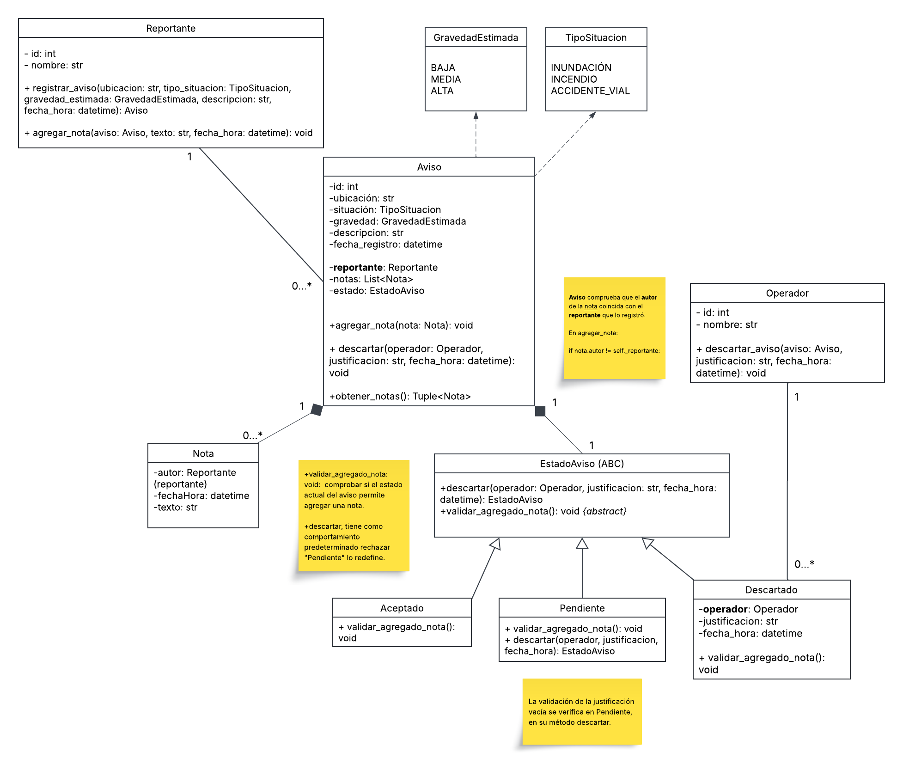
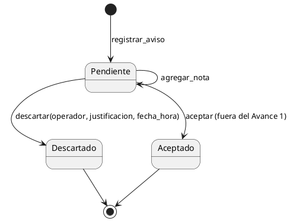

# Avance 1 – Avisos y notas

## 1. Alcance
Registrar un aviso, agregarle notas y descartarlo. Aceptar un aviso queda fuera.

| Regla | Contenido | Quién la hace cumplir | Test |
|---|---|---|---|
| R1 | El aviso nace pendiente con todos sus datos y valores de catálogo válidos | `Aviso.__init__`, `a_catalogo` | `test_r1_*` |
| R2 | Solo el reportante agrega notas, solo a avisos pendientes, texto no vacío | `Aviso.agregar_nota`, `EstadoAviso`, `Nota` | `test_r2_*` |
| R3 | Datos originales y notas inmutables | propiedades de solo lectura, `Nota` frozen | `test_r3_*` |
| R4 | Descartar exige justificación no vacía | `Pendiente.descartar` | `test_r4_*` |
| R5 | Un aviso descartado no admite notas ni otro descarte | `Descartado`, `EstadoAviso.descartar` | `test_r5_*` |
| R6 | Un rechazo no deja cambios parciales | validar antes de mutar | `test_r6_*` |

## 2. Diagrama de clases

## 3. Diagrama de estados (PlantUML)

## 4. Tarjetas CRC
| Clase | Responsabilidades | Colaboradores |
|---|---|---|
| Reportante | Registrar avisos; agregar notas a sus avisos | Aviso, Nota |
| Operador | Descartar avisos | Aviso |
| Aviso | Conservar sus datos; validar autor de la nota; delegar en su estado | EstadoAviso, Nota |
| Nota | Ser un valor inmutable y rechazar texto vacío | Reportante |
| EstadoAviso | Contrato: validar agregado de notas, descartar | Aviso |
| Pendiente | Permitir notas; validar justificación; producir `Descartado` | Descartado |
| Descartado | Conservar operador, justificación y fecha; rechazar operaciones | – |
| Aceptado | Rechazar notas y descarte (terminal) | – |

## 5. Decisiones
- **D1** – `Aviso` compara `nota.autor` con su reportante: es una relación con el recurso, propia del dominio. El control por perfil queda para la capa de aplicación (Avance 2).
- **D2** – La justificación se valida en `Pendiente.descartar`: la regla vive donde se decide la transición.
- **D3** – `estado` tiene valor por defecto `Pendiente()`; es seguro porque `Pendiente` no guarda datos.
- **D4** – El identificador es un `UUID` (stdlib) generado en `Reportante.registrar_aviso`.
- Sin `if/elif` por tipo ni banderas: el comportamiento depende del objeto de estado (polimorfismo).
- La fecha y hora llegan como parámetro; el dominio no llama a `datetime.now()`.
- Todos los rechazos son `ErrorDeDominio` (una subclase por regla).

## 6. Pregunta de defensa: ¿quién verifica que quien agrega la nota es el reportante?
`Aviso.agregar_nota`, porque es el único objeto que conoce a su reportante. Antes consulta a su estado si admite notas; el rechazo ocurre antes de modificar la colección.
